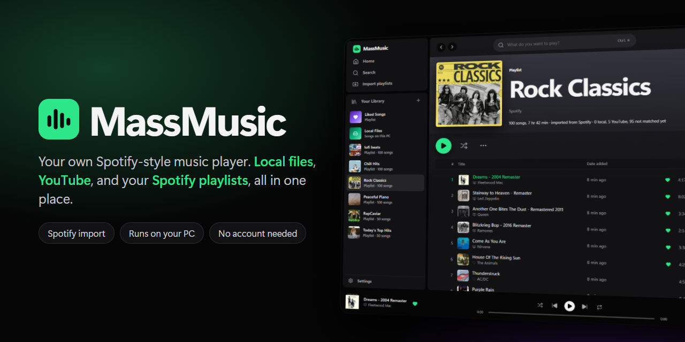
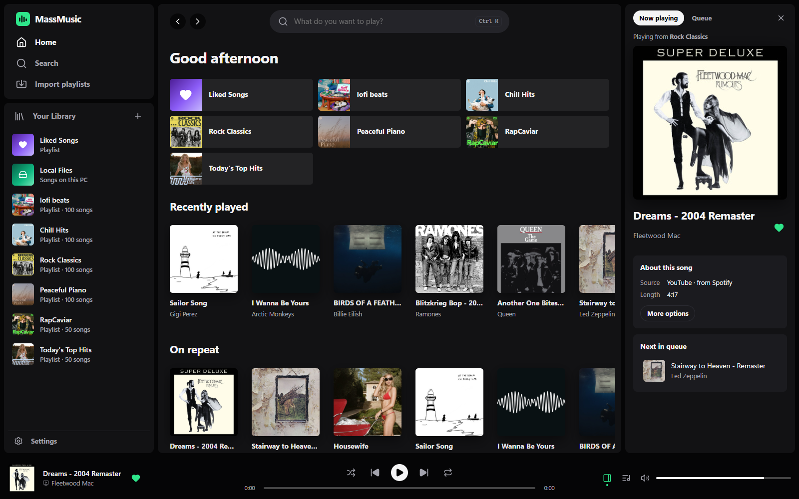
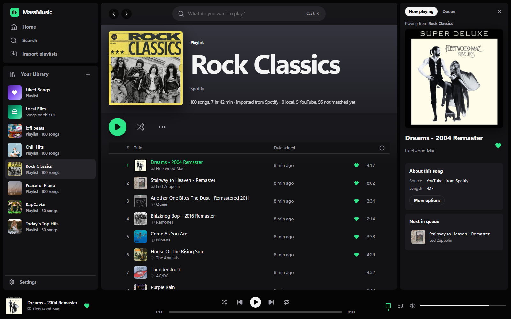
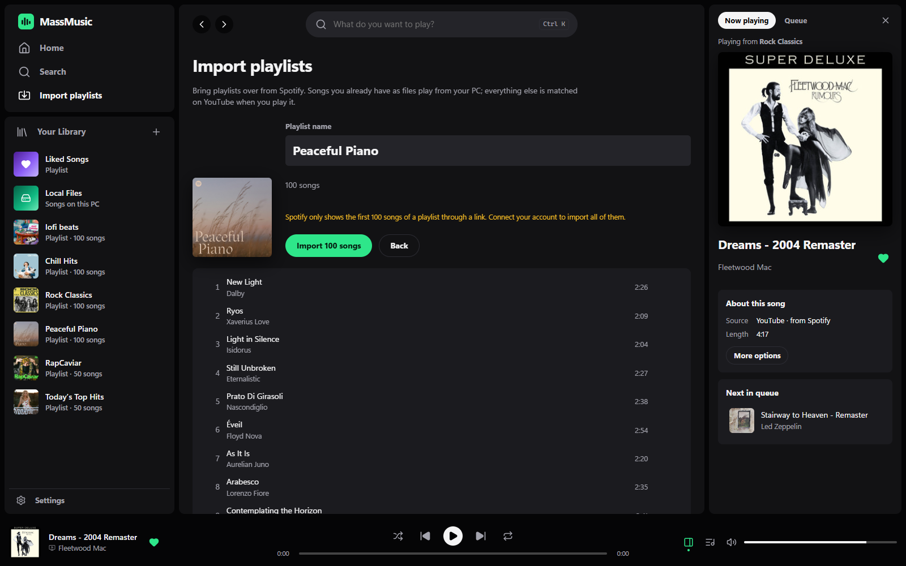
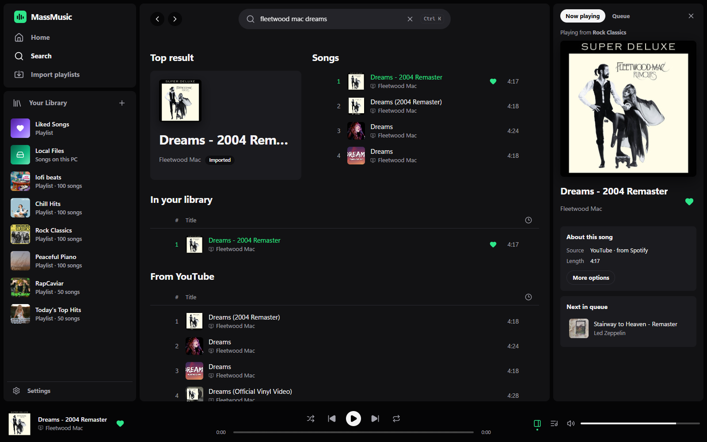
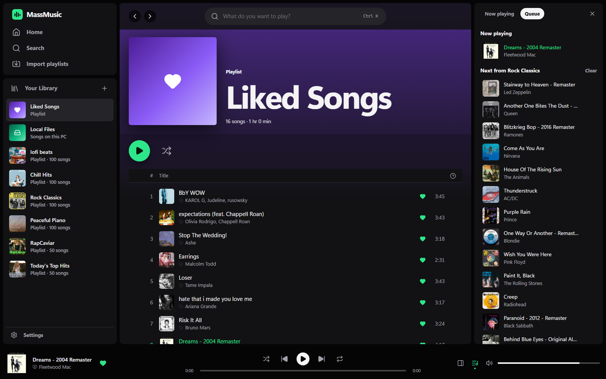
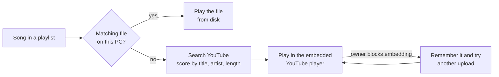

<p align="center">
  
</p>

<p align="center">
  
  
  
  
  
  
  
</p>

<p align="center">
  A personal Spotify-style music player that runs on your own PC.<br>
  It plays the music files you own, fills in the rest from YouTube, and imports your playlists straight from Spotify.
</p>

---

## Highlights

- **One library, two sources.** Your MP3, FLAC, M4A, OGG, OPUS and WAV files play straight from disk. Anything you don't own plays through YouTube's official embedded player.
- **Bring your Spotify playlists.** Paste a link, connect your account, or drop in a CSV. Songs you already have as files are matched automatically; the rest are found on YouTube the first time you play them.
- **Feels like the real thing.** Home with recently played and "on repeat", search, Liked Songs, playlists with drag-to-reorder, a queue, shuffle, repeat, a Now Playing panel with the video, and a mini player you can close.
- **A real desktop app.** Runs in its own window on Windows and Linux, with a Desktop shortcut and media-key support.
- **Yours only.** No account or cloud. Everything is stored in one local SQLite file, and the server only listens on your own machine.

## Screenshots

<table>
  <tr>
    <td width="50%"><p align="center"><sub><b>Home</b>: your playlists, recently played and on repeat</sub></p></td>
    <td width="50%"><p align="center"><sub><b>Playlists</b>: imported from Spotify, with the Now Playing panel</sub></p></td>
  </tr>
  <tr>
    <td width="50%"><p align="center"><sub><b>Import</b>: preview a Spotify playlist before adding it</sub></p></td>
    <td width="50%"><p align="center"><sub><b>Search</b>: your library and YouTube in one place</sub></p></td>
  </tr>
  <tr>
    <td colspan="2"><p align="center"><sub><b>Liked Songs and the queue</b></sub></p></td>
  </tr>
</table>

## Getting started

MassMusic runs as a **desktop app** in its own window (built with [Electron](https://www.electronjs.org)), so no browser is needed.

### Build and install the desktop app

You need [Node.js](https://nodejs.org) 22.13 or newer.

```bash
git clone https://github.com/Dyaus2/MassMusic.git
cd MassMusic
npm install
```

| System | Command | Result |
| --- | --- | --- |
| **Windows** | `npm run dist:win` | `release/MassMusic-Setup-<version>.exe`. Run it to install MassMusic for your user (no admin rights needed) with a Desktop and Start-menu shortcut. |
| **Linux** | `npm run dist:linux` (run on Linux) | `release/MassMusic-<version>.AppImage` and a `.deb` package. |

To try it without packaging, run `npm run desktop`.

Then:

1. Open **Settings** and add the folders where you keep music. They are scanned automatically.
2. Open **Import playlists** and paste a Spotify playlist link.
3. Press play.

The desktop app keeps your library in your user data folder (`%APPDATA%\MassMusic\data` on Windows, `~/.config/MassMusic/data` on Linux), so it survives reinstalls.

### Run it in a browser instead

```bash
npm run app          # builds the UI and opens http://localhost:4545
```

On Windows you can also double-click **`MassMusic.bat`**. This mode keeps its library in the project's `data/` folder.

> [!IMPORTANT]
> In browser mode, always open `http://localhost:4545`, not `http://127.0.0.1:4545`. YouTube blocks most music in players embedded on pages served from a raw IP address. MassMusic redirects you automatically, and the desktop app always uses `localhost`.

## Importing from Spotify

| Method | Login | Best for |
| --- | --- | --- |
| **Paste a link** | None | Public playlists, albums and songs. Spotify only exposes the first 100 songs of a playlist this way. |
| **Connect your account** | One-time setup | Private and large playlists, and your Liked Songs. |
| **CSV or text list** | None | [Exportify](https://exportify.app) CSVs, or plain `Artist - Title` lines. Exports from Apple Music, YouTube Music or Deezer work too. |

<details>
<summary><b>Connecting your Spotify account (about 2 minutes)</b></summary>

1. Go to the [Spotify developer dashboard](https://developer.spotify.com/dashboard) and create an app. Any name works; tick **Web API**.
2. Add this Redirect URI: `http://127.0.0.1:4545/api/spotify/callback`
3. Copy the app's **Client ID** into MassMusic → **Import playlists** → **Spotify account**, then click **Connect Spotify**.

MassMusic uses the PKCE login flow, so no client secret is needed. It only asks to read your playlists and Liked Songs, and the login stays on your PC.

</details>

## How playback works



Matches are saved, so each song is only looked up once. If a match is wrong, pick another version from the song's `…` menu.

## Keyboard shortcuts

| Keys | Action |
| --- | --- |
| <kbd>Space</kbd> | Play / pause |
| <kbd>Ctrl</kbd> + <kbd>→</kbd> / <kbd>←</kbd> | Next / previous song |
| <kbd>Shift</kbd> + <kbd>→</kbd> / <kbd>←</kbd> | Seek 5 seconds |
| <kbd>Ctrl</kbd> + <kbd>↑</kbd> / <kbd>↓</kbd> | Volume |
| <kbd>Ctrl</kbd> + <kbd>K</kbd> | Search |
| <kbd>M</kbd> · <kbd>S</kbd> · <kbd>R</kbd> | Mute · shuffle · repeat |
| <kbd>F11</kbd> | Full screen (desktop app) |

Your keyboard's media keys work too.

## Project layout

```text
electron/     Desktop app wrapper (window, starts the server)
server/       Express API: library scanner, SQLite, YouTube search, Spotify import
client/src/   React app: pages, components, and the player engine (lib/player.js)
docs/         README images
data/         Browser mode only: database and cover art (git-ignored)
```

| Command | What it does |
| --- | --- |
| `npm run desktop` | Build the UI and open the desktop app |
| `npm run dist:win` / `dist:linux` | Package the desktop app (installer / AppImage + deb) |
| `npm run app` | Build the UI and open MassMusic in your browser |
| `npm start` | Start the server (serves the last build) |
| `npm run dev` | Hot-reload development on <http://localhost:5173> |

## Notes and limits

- YouTube search and Spotify link import read the sites' public pages, so a big redesign on their side may need an update here.
- Some official music videos only play on youtube.com. MassMusic remembers those and switches to another upload, usually a lyric video.
- Your music files are only ever read, never changed. Delete the `data/` folder to start fresh.

## Disclaimer

MassMusic is a personal hobby project. It is not affiliated with, endorsed by, or connected to Spotify or YouTube. YouTube content plays through YouTube's official embedded player, and Spotify data is read only for playlists you choose to import.

## License

[MIT](LICENSE) © Dyaus2
